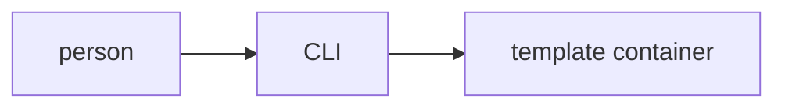

## Human-only segment

A segment for people only. The `:::llm` block right after it is what an LLM reads instead.

:::human
This segment is long on purpose: it walks a new reader through the idea, slowly, with a picture.

:::

:::llm
The person talks to the CLI, which calls the template container.
:::
