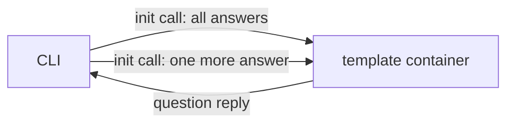

## Steps on any part

Steps are not a part of their own: any part becomes step by step when it holds `@step` lines (in mermaid, `%% @step`, a mermaid comment, so the diagram still draws anywhere). Here a diagram builds up one arrow per step.

