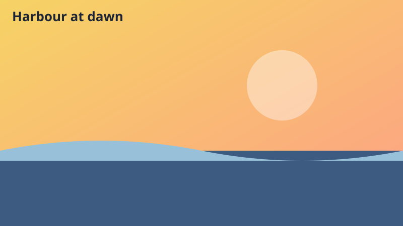
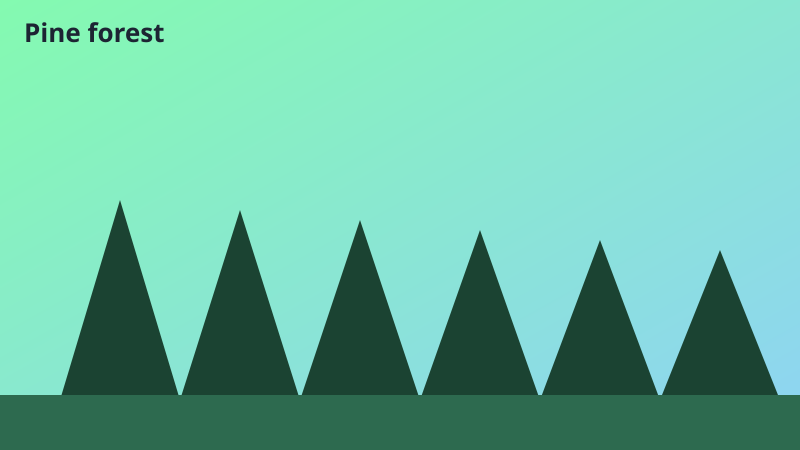
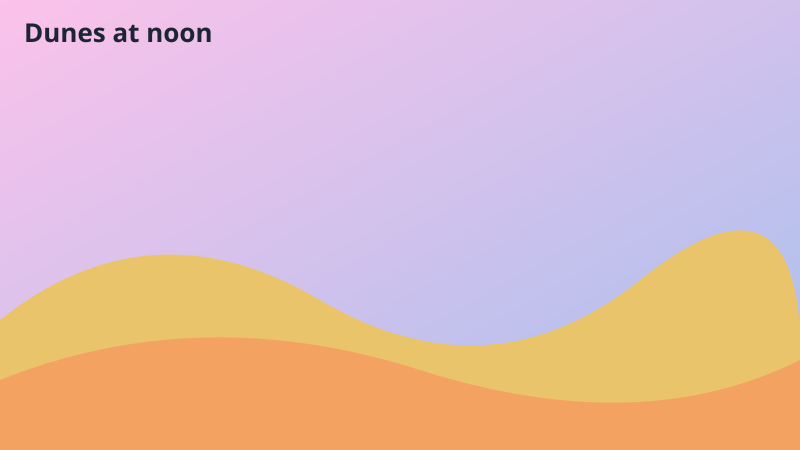
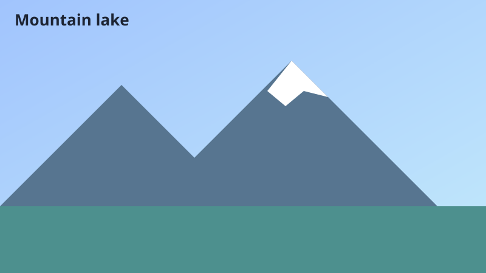

A carousel shows one image at a time: swipe, use the arrow keys, the buttons or the dots. A tap opens the picture full screen, where pinch, wheel and double tap zoom it, and one finger or the mouse pans.

```gallery title="Four sample pictures" view=carousel loop




```

A grid crops to a ratio (the full picture stays in the lightbox), with the caption under each image.

```gallery title="The same pictures, as a grid" view=grid columns=3 ratio=4:3


```

One image, with zoom.

```gallery view=single

```
